# Clock32 user interface

The firmware drives a 128x64 SH1106 OLED and takes all input from a single
rotary encoder: **rotate**, **press** and **long press**. There are four faces.

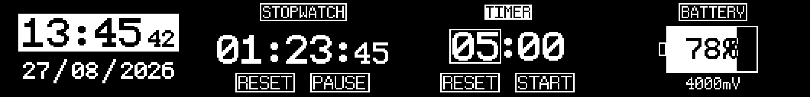

Every image on this page is 3x scaled and generated from the layout in
`Core/Src/display_draw.c` — see [Regenerating the images](#regenerating-the-images).

## Navigation

| Input | Face not focused | Face focused |
| --- | --- | --- |
| Rotate | next / previous face, clockwise advances: clock → stopwatch → timer → battery | move the selection |
| Press | focus the face | act on the selected item (start, reset, edit) |
| Long press | — | leave the face (back to face selection) |

The battery face is read-only, so it never takes focus.

## Clock

| Not focused | Hours selected | Editing minutes | Editing the year |
| --- | --- | --- | --- |
| 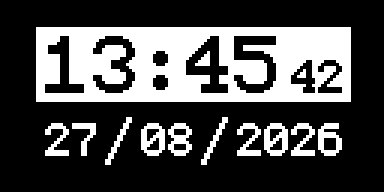 | 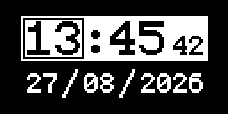 | 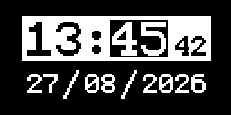 | 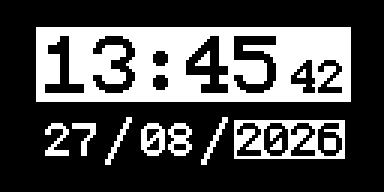 |

The time sits on an inverse-video block; the date is drawn below it.

- **Focus** — a hollow box appears on the selected field.
- **Rotate** — moves the box through hours → minutes → seconds → day → month → year.
- **Press** — fills the box; rotating now changes that field, and each change is
  written to the RTC straight away. Press again to go back to selecting.
- **Long press** — leaves the face.

While the face is focused it shows a snapshot taken at the moment of focusing, so
the numbers do not move underneath the cursor; the RTC keeps running in the
background and the face catches up when the face is left. Because the marker is
drawn with the XOR colour it stays readable both on the inverted time block and
on the plain date line.

Days wrap inside the current month, and changing the month or year clamps the day
where needed (31 → 30, or 29 → 28 in a non-leap February). The year is held
between 2020 and 2099, which is the range the RTC accepts.

## Stopwatch

| Idle | Running | Focused, START/PAUSE selected |
| --- | --- | --- |
| 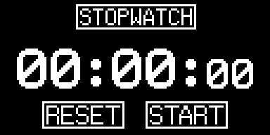 | 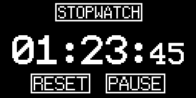 | 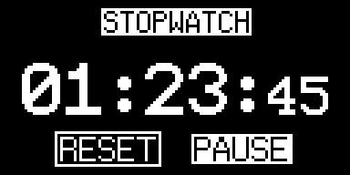 |

- **Focus** — the title box and the currently selected button invert.
- **Rotate** — swaps the selection between RESET and START/PAUSE.
- **Press** — acts on the selected button: start/pause the count, or reset it to zero.
- **Long press** — leaves the face.

Hours and minutes use the 29 px font and the seconds the 22 px font, so the
column widths stay fixed while the count runs.

## Timer

| Idle, minutes selected | Editing seconds | Running | Paused | Alarm |
| --- | --- | --- | --- | --- |
| 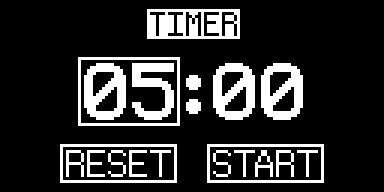 | 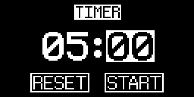 | 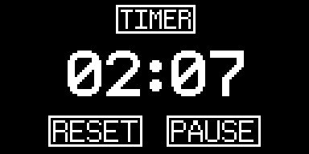 | 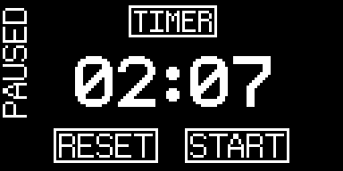 | 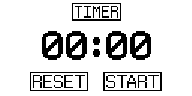 |

- **Focus** — the title box inverts, and while the timer is idle a hollow box
  appears on the selected field.
- **Rotate** — moves the selection: minutes → seconds → RESET → START/PAUSE.
- **Press** — on minutes or seconds it starts/stops editing that value; on
  START/PAUSE it starts the countdown (when a non-zero time is set); on RESET it
  reloads the configured time.
- **Long press** — leaves the face.

When the countdown reaches zero the buzzer sounds and the whole screen is XORed
in time with it (the `Alarm` image above) until it is acknowledged. A paused
timer shows the rotated `PAUSED` label down the left edge.

## Battery

| 78 % at 4000 mV | 7 % at 3400 mV |
| --- | --- |
| 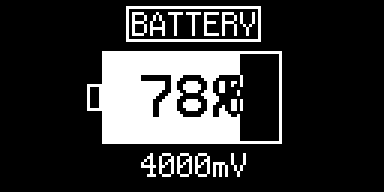 | 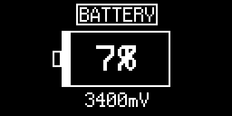 |

The charge bar is inverted inside the battery shell so the percentage stays
readable over the filled part, and the measured cell voltage is shown underneath
so the reading can be compared with a multimeter. The reading is refreshed every
10 s (`BATTERY_SAMPLE_PERIOD_MS`); the divider is only powered for the few
milliseconds it takes to measure, so it does not drain the cell. The same values
are available over the UART console with the `batt` command.

## Regenerating the images

`docs/ui_render.py` reproduces each screen off-target: it re-implements the few
u8g2 primitives the firmware uses (box, frame, string with the RLE glyph decoder,
XOR colour and rotated text) and reads the real font data from
`Drivers/u8g2/csrc/u8g2_fonts.c`.

```sh
python docs/ui_render.py
```

It needs Python 3.8+ and no third-party packages, and rewrites everything in
`docs/images/`. The glyphs therefore match the firmware exactly, but the
**coordinates are a manual mirror of `Core/Src/display_draw.c`**: when a layout
changes there, change the matching function in the script too, or the pictures
will drift from the device.
